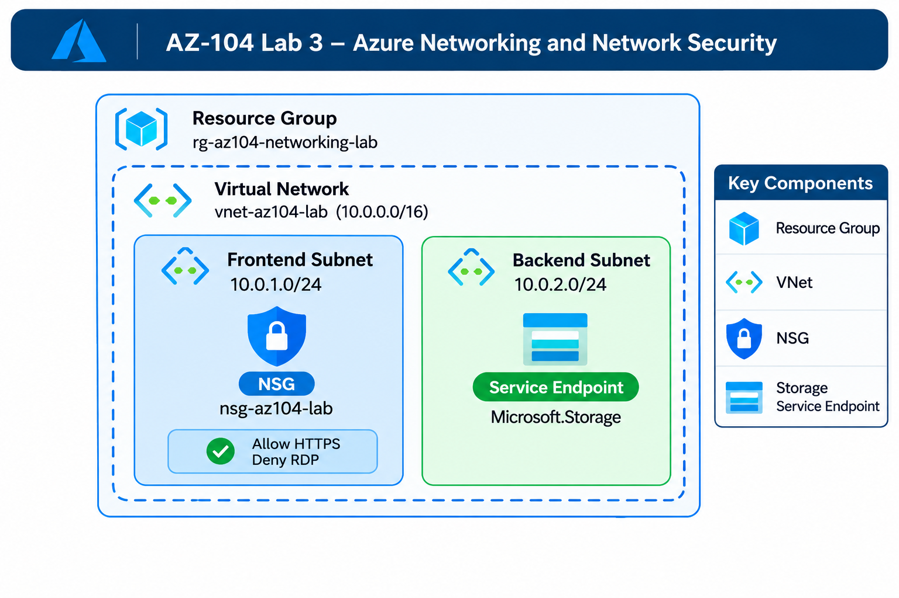
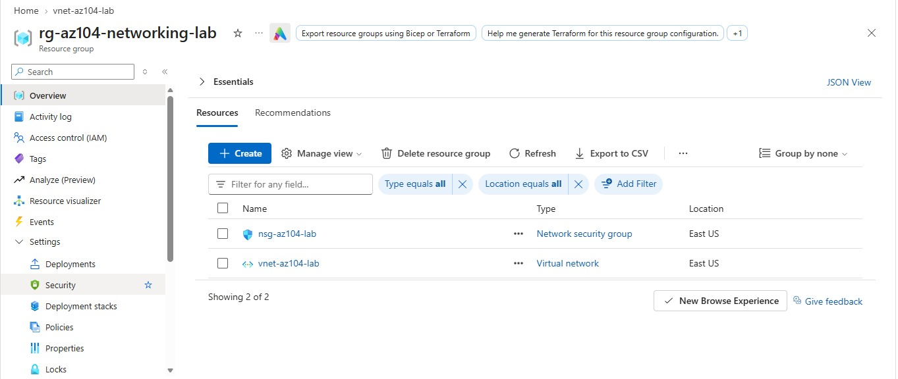
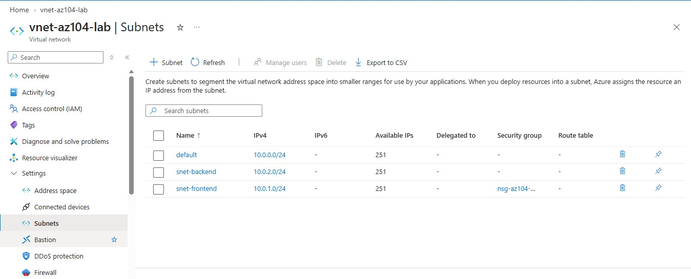
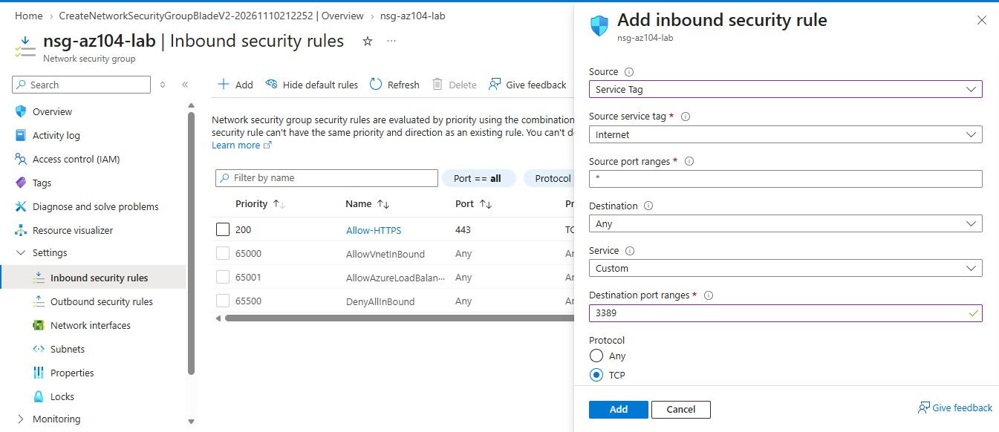
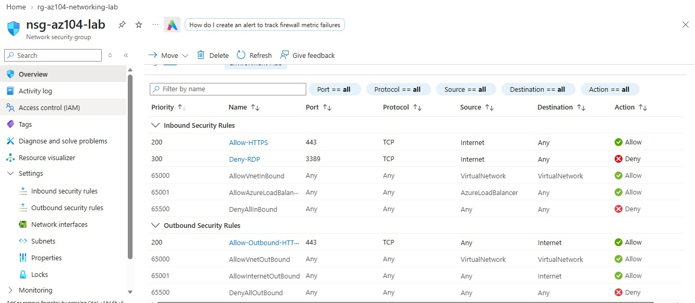
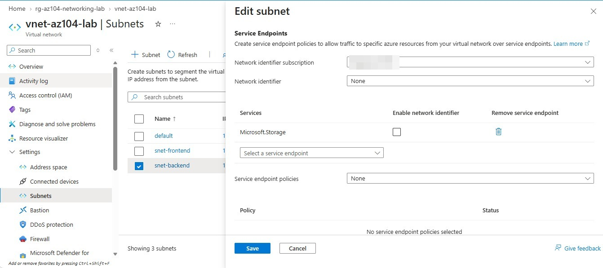

# AZ-104 Week 3 — Azure Networking and Network Security

## Overview
This lab focused on the building blocks of Azure networking: how a virtual network organizes address space, how subnets divide that space into smaller ranges, and how a Network Security Group (NSG) controls traffic. I also enabled a service endpoint on a subnet and practised CIDR notation to understand how address ranges are calculated.

This was a configuration and concepts lab done in the Azure portal. No virtual machine or workload was deployed, so no traffic was sent through the network (see [Scope and Limitations](#scope-and-limitations)).

## Objectives
- Understand how a virtual network and its subnets organize network resources.
- Practise CIDR notation and work out subnet address ranges.
- Create an NSG with custom inbound and outbound rules and associate it with a subnet.
- Inspect the default NSG rules and understand how rule priority works.
- Enable a service endpoint on a subnet and understand what it does.

## Azure Services and Concepts
- Resource Groups and tags
- Virtual Networks (VNet)
- Subnets
- CIDR notation and Azure's reserved IP addresses
- Network Security Groups (NSG): inbound rules, outbound rules, default rules, priorities
- Service Endpoints (`Microsoft.Storage`)

## Resources Created

| Resource | Name | Configuration |
|---|---|---|
| Resource group | `rg-az104-networking-lab` | East US; tags `Project: AZ-104`, `Environment: Lab`, `Purpose: Networking Practice` |
| Virtual network | `vnet-az104-lab` | Address space `10.0.0.0/16` |
| Subnet | `snet-frontend` | `10.0.1.0/24`; NSG associated |
| Subnet | `snet-backend` | `10.0.2.0/24`; `Microsoft.Storage` service endpoint enabled |
| Network security group | `nsg-az104-lab` | Associated with `snet-frontend`; custom rules listed below |

The virtual network also contains a `default` subnet (`10.0.0.0/24`). It was already there, and I left it unchanged.

## Architecture



Text view of the same layout:

```
Azure Subscription
└── Resource Group: rg-az104-networking-lab
    ├── Virtual Network: vnet-az104-lab (10.0.0.0/16)
    │   ├── Subnet: snet-frontend (10.0.1.0/24)  ← NSG associated
    │   ├── Subnet: snet-backend  (10.0.2.0/24)  ← Microsoft.Storage service endpoint
    │   └── Subnet: default       (10.0.0.0/24)
    └── Network Security Group: nsg-az104-lab
```

## Implementation

### 1. Resource Group and Resources
I created `rg-az104-networking-lab` in East US as a single container for everything in this lab. The two networking resources I created, the virtual network `vnet-az104-lab` and the network security group `nsg-az104-lab`, sit inside it. I also tagged the resource group with `Project`, `Environment`, and `Purpose`.


*The resource group showing the two resources created in this lab: the network security group and the virtual network. No virtual machines or other compute resources were deployed.*

### 2. Virtual Network and Subnets
I created `vnet-az104-lab` with the address space `10.0.0.0/16`, then defined two subnets inside it: `snet-frontend` (`10.0.1.0/24`) and `snet-backend` (`10.0.2.0/24`). The two subnets are separate, non-overlapping ranges carved out of the larger address space.


*Subnets in `vnet-az104-lab`. Each /24 shows 251 available IPs, and the Security group column shows the NSG associated with `snet-frontend` (name truncated by the portal).*

### 3. Network Security Group and Custom Rules
I created `nsg-az104-lab` and associated it with `snet-frontend`. I then added custom rules:

| Direction | Name | Priority | Port | Protocol | Source / Destination | Action |
|---|---|---|---|---|---|---|
| Inbound | `Allow-HTTPS` | 200 | 443 | TCP | Source: Internet | Allow |
| Inbound | `Deny-RDP` | 300 | 3389 | TCP | Source: Internet | Deny |
| Outbound | `Allow-Outbound-HTTPS` | 200 | 443 | TCP | Destination: Internet | Allow |


*Adding an inbound rule for TCP port 3389 (RDP) using the Internet service tag as the source. The `Allow-HTTPS` rule at priority 200 is already visible behind the panel.*

### 4. Inspecting the Default Rules
I reviewed the default rules Azure adds to every NSG. They use priorities 65000–65500, so any custom rule with a lower number is evaluated first.


*Custom rules at the top of each list, with the default rules below: `AllowVnetInBound`, `AllowAzureLoadBalancerInBound`, `DenyAllInBound`, `AllowVnetOutBound`, `AllowInternetOutBound`, and `DenyAllOutBound`.*

### 5. Service Endpoint
I enabled the `Microsoft.Storage` service endpoint on `snet-backend` and saved the change. A service endpoint extends the subnet's identity to a supported Azure service, so that service can recognize traffic coming from that subnet. No storage account was created or restricted in this lab, so this was a configuration exercise only.


*Edit subnet pane for `snet-backend` showing the `Microsoft.Storage` service endpoint.*

### 6. IP Addressing and CIDR
I practised CIDR notation and worked out the address ranges involved:

| CIDR | Addresses | Range in this lab |
|---|---|---|
| `/16` | 65,536 | `10.0.0.0` – `10.0.255.255` (the virtual network) |
| `/24` | 256 | `10.0.1.0` – `10.0.1.255` (frontend), `10.0.2.0` – `10.0.2.255` (backend) |

Azure reserves five IPv4 addresses in every subnet: the network address, the default gateway, two addresses for Azure DNS, and the broadcast address. That leaves 251 usable addresses in a /24, which matches the "Available IPs" column in the subnet screenshot above.

## Scope and Limitations
- I did not deploy a virtual machine or any other workload.
- I did not perform connectivity testing, so I have not observed the NSG rules allowing or blocking real traffic.
- Everything here was done and verified in the Azure portal.
- This is a learning lab, not production experience.

## Key Concepts Learned
- **Address space and subnets:** a virtual network's address space is divided into subnets, which lets related resources be grouped and secured separately.
- **NSG rule evaluation:** rules are processed in priority order, lowest number first, and processing stops at the first matching rule.
- **Default rules:** every NSG includes default rules at priorities 65000–65500. They cannot be deleted, but a custom rule with a lower number is evaluated before them.
- **Explicit vs. default deny:** `DenyAllInBound` already blocks unsolicited inbound traffic, so `Deny-RDP` mostly makes the intent explicit. Because it has a lower number than any later rule, it would also take precedence over a future allow rule with a higher number.
- **Subnet-level NSG association:** associating an NSG with `snet-frontend` means its rules apply to resources placed in that subnet.
- **Service endpoints:** they extend a subnet's identity to supported Azure services such as Azure Storage.
- **Reserved addresses:** Azure reserves five IPs per subnet, so a /24 gives 251 usable addresses, not 256.

## Validation
Using the Azure portal, I confirmed that:
- The resource group contains the virtual network and the NSG.
- The subnets have the intended ranges and each shows 251 available IPs.
- The NSG is associated with `snet-frontend`.
- The custom inbound and outbound rules show the intended ports, priorities, and actions, alongside the default rules.
- The `Microsoft.Storage` service endpoint is listed for `snet-backend`.

No traffic or connectivity tests were performed.

## Cleanup
I deleted the lab resources after completing and verifying the configuration, to keep the shared Azure environment clean.

## Key Takeaways
- Planning address space first makes it easy to add subnets later without overlap.
- NSG priorities decide which rule wins, so understanding the order matters as much as writing the rules.
- A deny-by-default posture, plus a small number of explicit allow rules, is a simple and readable way to control traffic.
- Configuring resources and understanding the concepts is a useful first step, and testing with a real workload is the natural next step for a later lab.

---
*This lab was completed as part of a self-directed, hands-on AZ-104 study portfolio. It reflects a learning environment, not production experience.*
